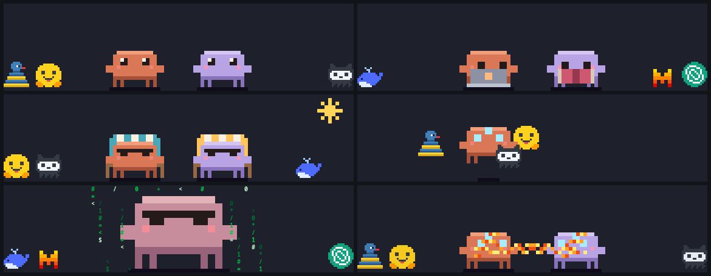

# Pixel Claude

Two pixel-art beasts that live in the bottom-right corner of a Wayland desktop: a terracotta one and its
pastel purple friend. They mostly keep to themselves while you work, and get up to something now and then.



This is an unofficial fan toy. It is not affiliated with or endorsed by Anthropic, and the floor toys are
hand-drawn doodles that only nod at other projects' logos.

## What they do

Most of the time (around 85 to 90 percent) they are calm:

- watch you, read, study (one on a laptop, one with a book), nap, or sunbathe in deck chairs with sunglasses

Now and then something happens:

- one walks over and gives the other a flower
- they toss one of the floor toys back and forth
- one walks off the edge of the monitor; the one left behind levitates and meditates while the toys orbit it,
  and whoever comes back brings new toys
- they fuse into one big creature in sunglasses, with falling code around it and the odd glitch
- a thought or a greeting in a speech balloon

And they react to the mouse:

- put the pointer on a creature and it scurries away, while the widget turns see-through so you can see under it
- put the pointer on a toy and the nearest one firebends it away
- click a creature and it waves hello

Everything else is click-through, so the widget never blocks the windows behind it.

## Requirements

- Linux with a Wayland compositor that supports the layer-shell protocol (COSMIC, Sway, Hyprland, KDE Plasma;
  not GNOME)
- Python 3 with GTK 4, PyGObject, pycairo and gtk4-layer-shell

On Arch-based systems:

```
sudo pacman -S python-gobject python-cairo gtk4 gtk4-layer-shell
```

There are no Python packages to install.

## Run

```
git clone <this repo> && cd pixel-claude
./summon_beasts          # they appear, bottom-right
./send_away              # someone shouts "dracarys" and they leave in flames
```

To have both commands everywhere:

```
ln -s "$PWD/summon_beasts" "$PWD/send_away" ~/.local/bin/
```

`summon_beasts 5` makes them smaller and `summon_beasts 7` bigger (the number is screen pixels per art pixel,
6 by default). `pkill -f pixel_claude_gtk` stops them at once, without the show.

If they sit too high or too low on your screen, change `MARGIN_BOTTOM` at the top of `pixel_claude_gtk.py`.

## Terminal version

`python3 pixel_claude.py` runs the same two creatures inside any truecolor terminal, under a night sky, using
half-block characters as pixels. It has no toys and no mouse interaction. Ctrl-C quits.

## Files

| File | What it is |
| --- | --- |
| `pixel_claude.py` | The art and all the behaviour, plus the terminal renderer. Standard library only. |
| `pixel_claude_gtk.py` | The desktop widget: draws the same scene with GTK 4 and handles the mouse. |
| `pixel_claude_check.py` | Self-check: `python3 pixel_claude_check.py` renders every activity and runs long simulations. |
| `summon_beasts`, `send_away` | The two commands. |

Sprites are small grids of letters in the source, mapped to colours by a palette, so they are easy to edit:
look for `BODY`, `TOYS` and `PAL` in `pixel_claude.py`.

## Credits and licence

Ideas and direction by Ricardo A; drawn and written with [Claude Code](https://claude.com/claude-code), which
was asked to make a pixel portrait of itself and got carried away.

MIT licensed, see [LICENSE](LICENSE).
